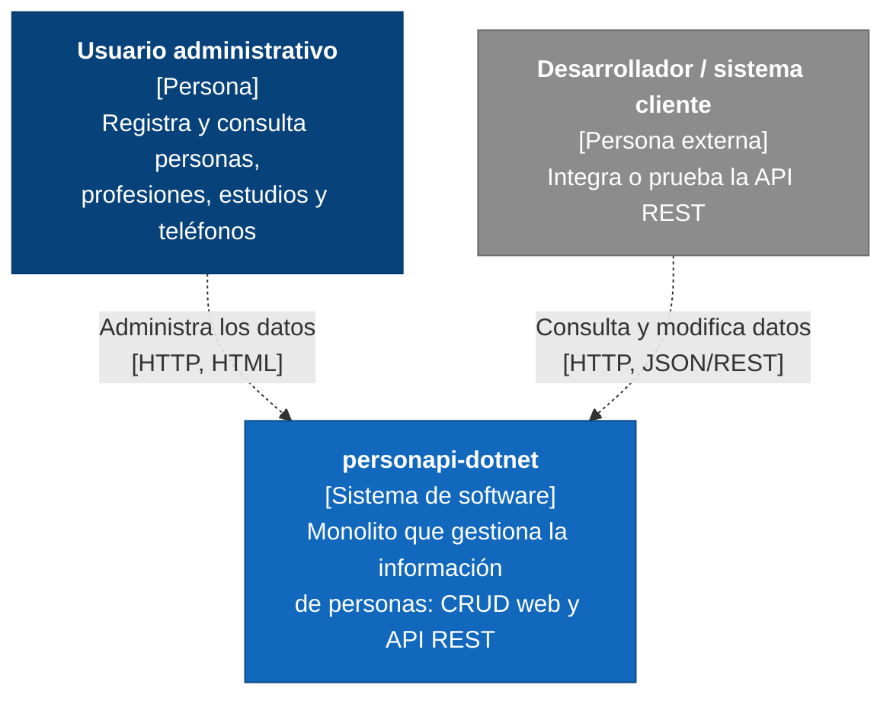
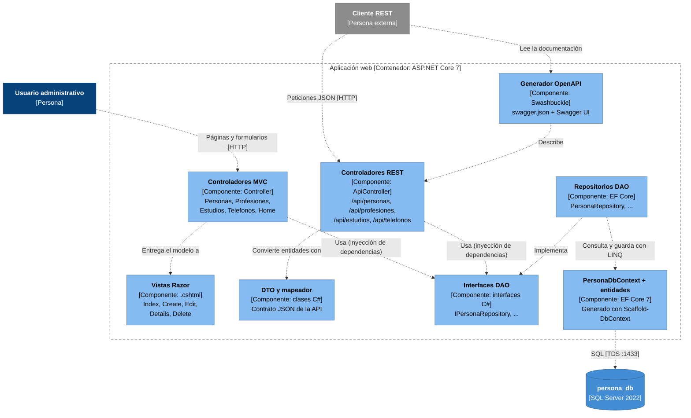
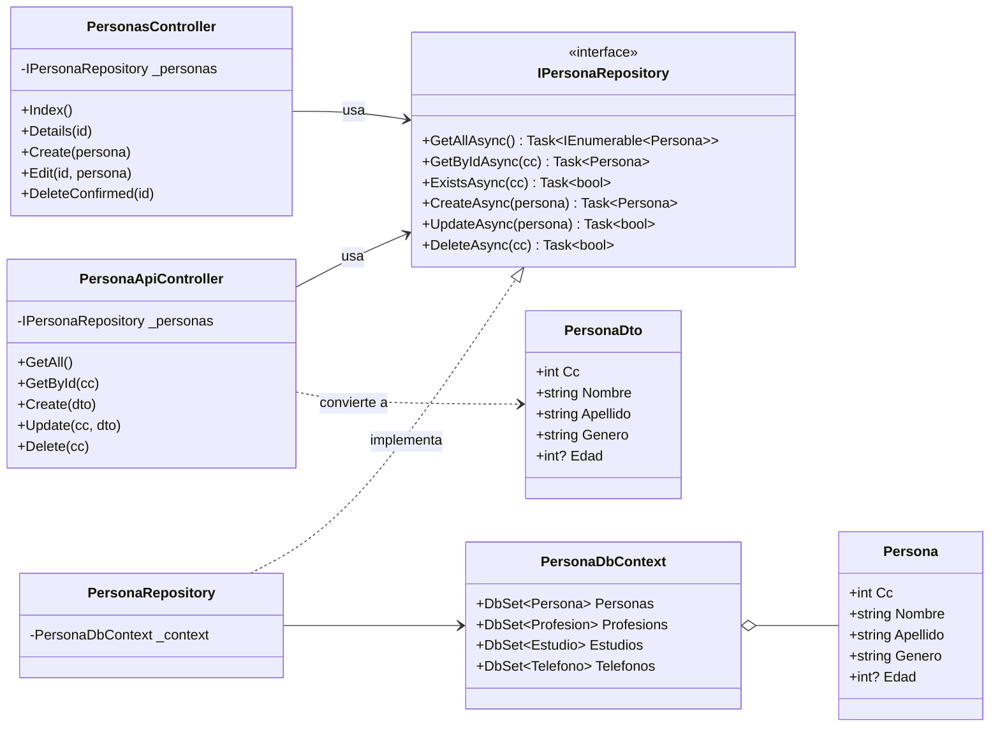
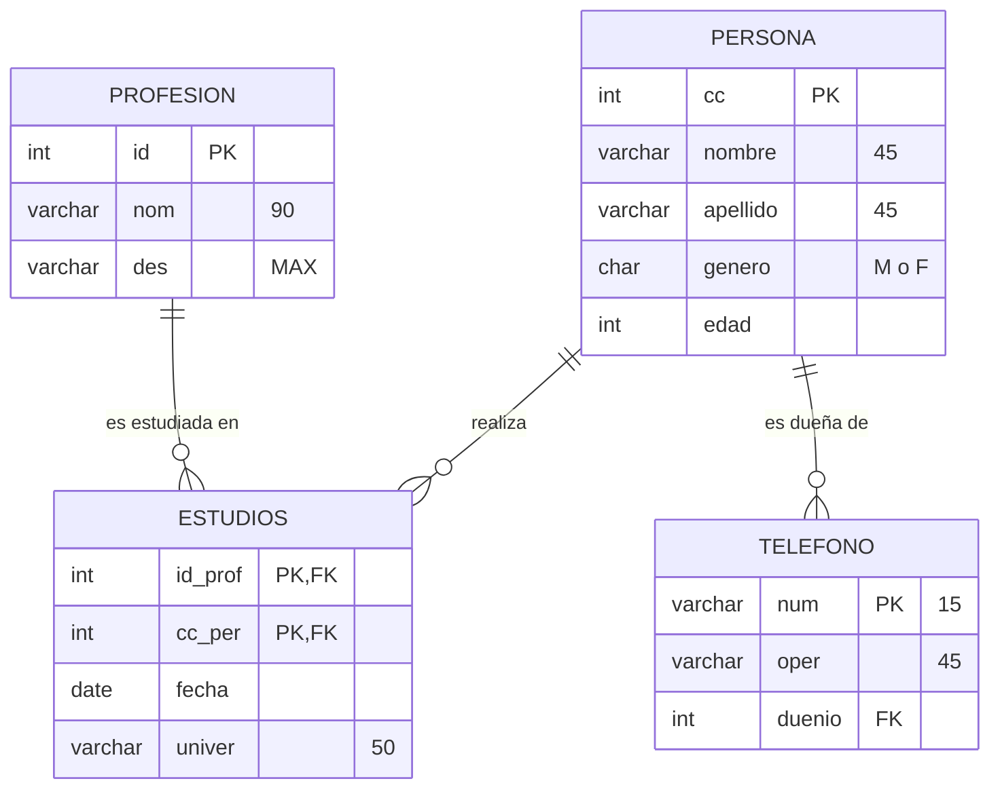
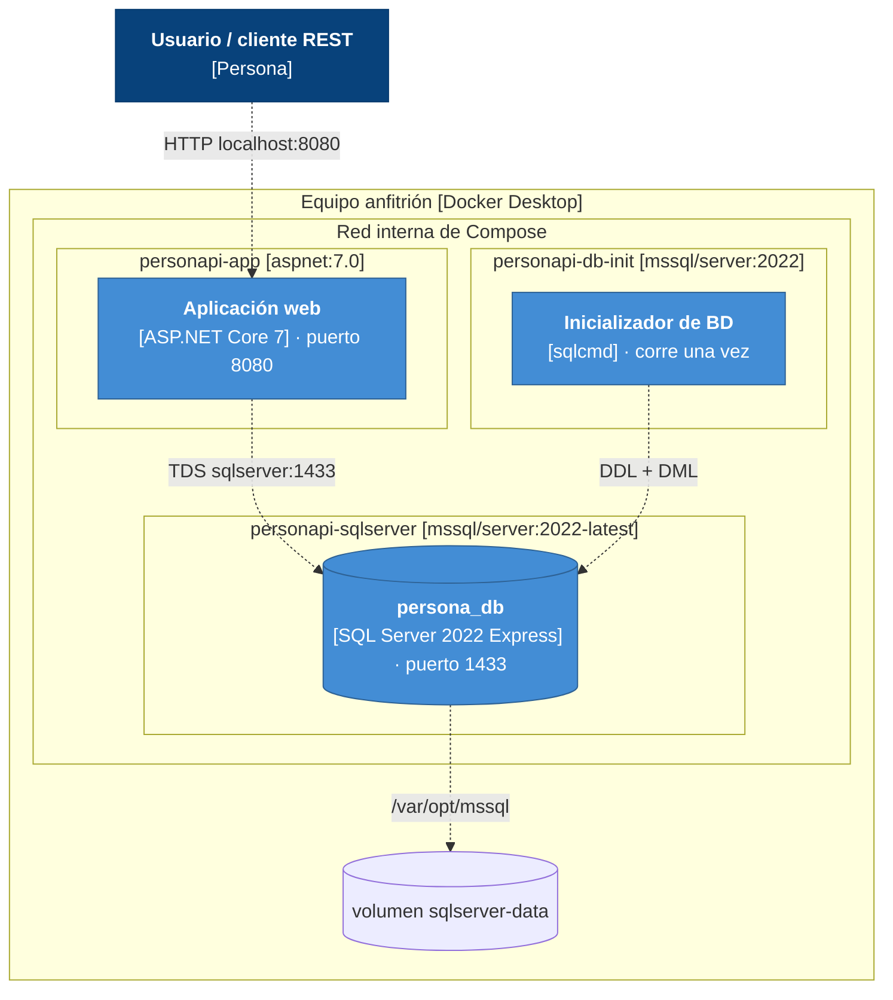

# Arquitectura de personapi-dotnet (modelo C4)

El modelo C4 describe un sistema de software en cuatro niveles de zoom. Cada nivel responde una pregunta distinta:

| Nivel | Diagrama | Pregunta que responde |
|---|---|---|
| 1 | Contexto | ¿Quién usa el sistema y con qué se relaciona? |
| 2 | Contenedores | ¿En qué piezas desplegables se divide (aplicación, base de datos...)? |
| 3 | Componentes | ¿Cómo está organizado por dentro el contenedor principal? |
| 4 | Código | ¿Cómo se ven las clases de un componente concreto? |

Además se incluye el diagrama de despliegue, que muestra dónde corre cada contenedor.

Convenciones de color (las de C4): azul oscuro = persona, azul = sistema, azul medio = contenedor, azul claro = componente, gris = actor externo. Las líneas punteadas son relaciones y su texto dice qué se hace y con qué tecnología.

Los diagramas están escritos como código (Mermaid), así GitHub los dibuja directamente y quedan versionados junto al proyecto. La definición formal del modelo está en [`c4/workspace.dsl`](c4/workspace.dsl) (Structurizr DSL), que se puede abrir en <https://structurizr.com/dsl> para ver los mismos diagramas.

---

## Nivel 1 · Contexto

personapi-dotnet es un solo sistema que usan dos tipos de actores: una persona desde el navegador y cualquier programa que consuma la API REST.

## Nivel 2 · Contenedores

Por dentro, el sistema tiene tres contenedores: la aplicación web (el monolito), la base de datos y un contenedor que solo se ejecuta al desplegar para crear las tablas.

## Nivel 3 · Componentes de la aplicación web

Aquí se ven los patrones del laboratorio: **MVC** (controladores + vistas + modelo) y **DAO** (interfaces + repositorios). Los controladores de vistas y los de la API comparten la misma capa DAO, por eso no se repite lógica de acceso a datos.

## Nivel 4 · Código (patrón DAO aplicado a Persona)

Las otras tres entidades siguen exactamente la misma forma. En `estudios` los métodos reciben las dos partes de la llave compuesta.

### Modelo de datos

## Despliegue

Con Docker Compose los tres contenedores corren en una red interna. Solo se publican al equipo los puertos 8080 (aplicación) y 1433 (SQL Server, para revisarlo con SSMS).

