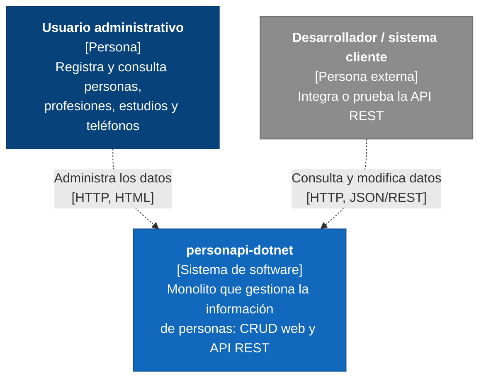
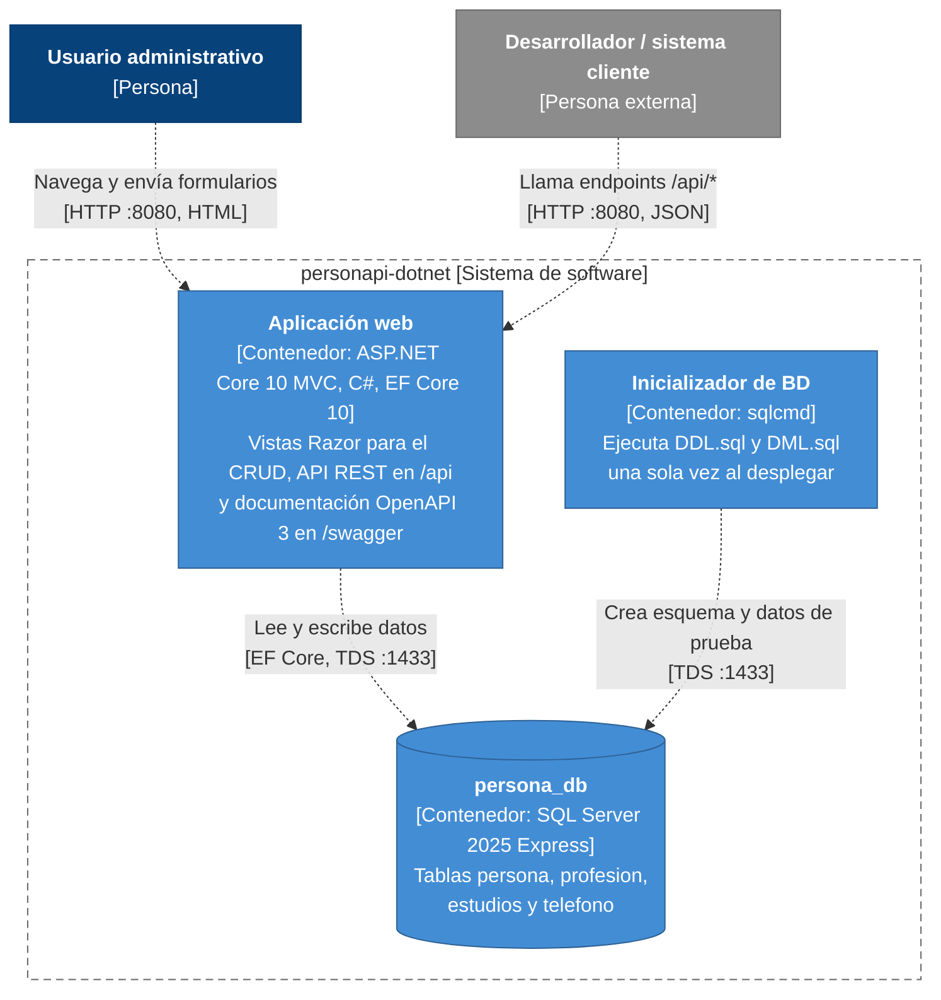
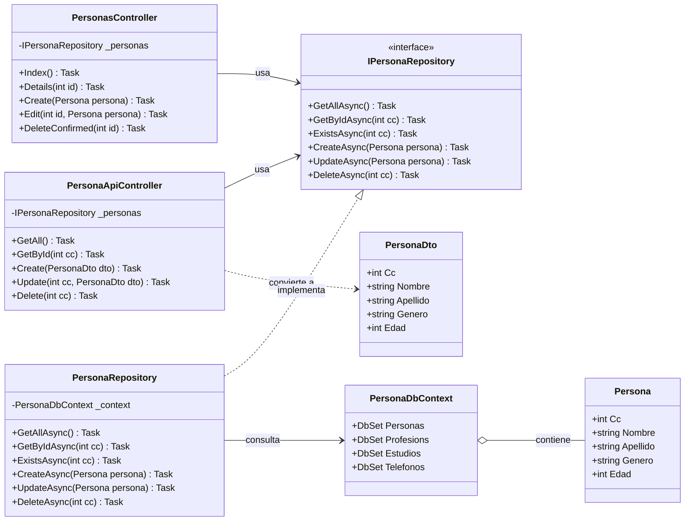
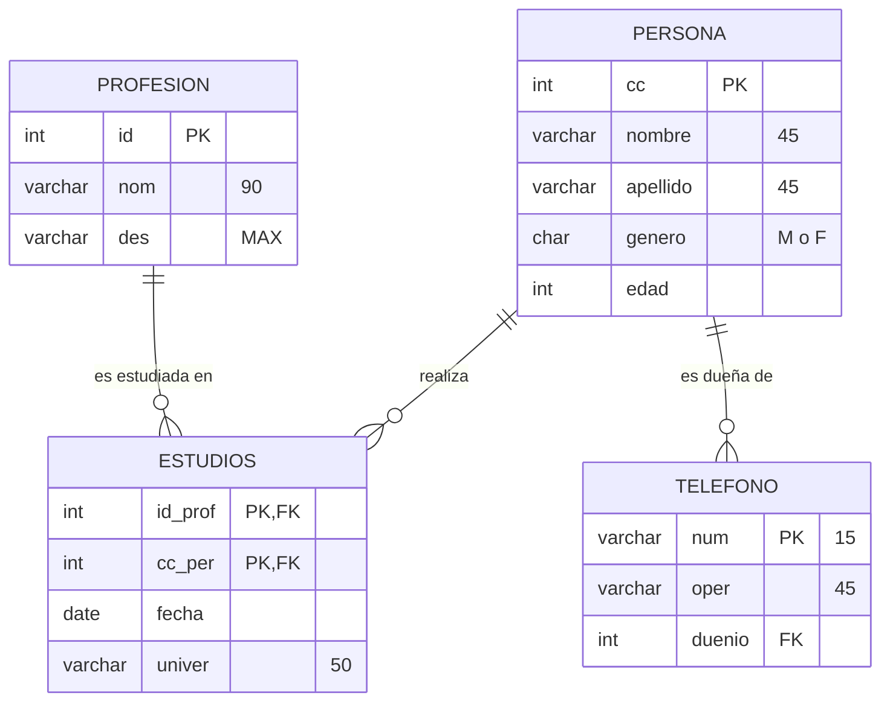

# Arquitectura de personapi-dotnet (modelo C4)

El modelo C4 describe la arquitectura del sistema de software en cuatro niveles de abstracción progresiva:

| Nivel | Diagrama | Pregunta que responde | Artefacto PNG |
|---|---|---|---|
| 1 | Contexto | ¿Quién usa el sistema y con qué se relaciona? | [`c4-nivel1-contexto.png`](diagramas/c4-nivel1-contexto.png) |
| 2 | Contenedores | ¿En qué piezas desplegables se divide la solución? | [`c4-nivel2-contenedores.png`](diagramas/c4-nivel2-contenedores.png) |
| 3 | Componentes | ¿Cómo está organizado por dentro el contenedor principal? | [`c4-nivel3-componentes.png`](diagramas/c4-nivel3-componentes.png) |
| 4 | Código | ¿Cómo se estructuran las clases y contratos del patrón DAO? | [`c4-nivel4-codigo.png`](diagramas/c4-nivel4-codigo.png) |
| - | Secuencia CRUD | ¿Cómo interactúan los componentes en CREATE, READ, UPDATE, DELETE? | [`secuencia-crud-*.png`](diagramas/) |
| - | Despliegue | ¿Cómo se distribuyen y comunican los contenedores en Docker? | [`c4-despliegue.png`](diagramas/c4-despliegue.png) |
| - | Modelo ER | ¿Cuál es el modelo relacional de la base de datos? | [`diagrama-er.png`](diagramas/diagrama-er.png) |

---

## Nivel 1 · Contexto del Sistema

Describe las interacciones de los usuarios finales y sistemas clientes con el monolito `personapi-dotnet`.

Ver código fuente Mermaid

---

## Nivel 2 · Contenedores

Muestra las unidades de ejecución independientes orquestadas mediante Docker Compose: aplicación web, base de datos e inicializador automatizado.

Ver código fuente Mermaid

---

## Nivel 3 · Componentes de la Aplicación Web

Detalla los módulos internos del contenedor web organizados bajo los patrones arquitecturales **MVC** y **DAO**.

Ver código fuente Mermaid

---

## Nivel 4 · Código (Patrón DAO)

Diagrama de clases representativo de la implementación del patrón DAO para la entidad `Persona`. Las entidades `Profesion`, `Estudio` y `Telefono` siguen exactamente la misma estructura.

Ver código fuente Mermaid

---

## Modelo Entidad - Relación (Base de Datos)

Diagrama relacional correspondiente al esquema de base de datos implementado en `db/DDL.sql` (adaptado desde el modelo original `persona_ddl_mysql.sql`).

Ver código fuente Mermaid

---

## Despliegue en Docker Compose

Orquestación de los contenedores dentro de la red aislada de Compose, mapeando puertos de exposición hacia el host y administrando el volumen de almacenamiento persistente para SQL Server.

Ver código fuente Mermaid

---

## Diagramas de Secuencia UML (Operaciones CRUD)

Modelado formal del comportamiento dinámico e interacción temporal entre componentes del sistema (Cliente HTTP, Controladores MVC y REST, Capa DAO de Repositorios, Entity Framework Core y Microsoft SQL Server 2025):

| Operación | Descripción del Flujo | Artefacto PNG |
|---|---|---|
| **CREATE** | Inserción con validación de DataAnnotations, verificación de unicidad de clave y respuesta HTTP 201 Created | [`secuencia-crud-create.png`](diagramas/secuencia-crud-create.png) |
| **READ** | Consulta optimizada con `AsNoTracking`, carga diligente de relaciones (`Include`/`ThenInclude`) y respuesta HTTP 200 OK | [`secuencia-crud-read.png`](diagramas/secuencia-crud-read.png) |
| **UPDATE** | Modificación con validación de consistencia de clave primaria, actualización atómica y respuesta HTTP 204 No Content | [`secuencia-crud-update.png`](diagramas/secuencia-crud-update.png) |
| **DELETE** | Eliminación de registro raíz con activación de borrado en cascada (`ON DELETE CASCADE`) en SQL Server | [`secuencia-crud-delete.png`](diagramas/secuencia-crud-delete.png) |

### 1. Creación (CREATE)

### 2. Lectura (READ)

### 3. Actualización (UPDATE)

### 4. Eliminación (DELETE)

