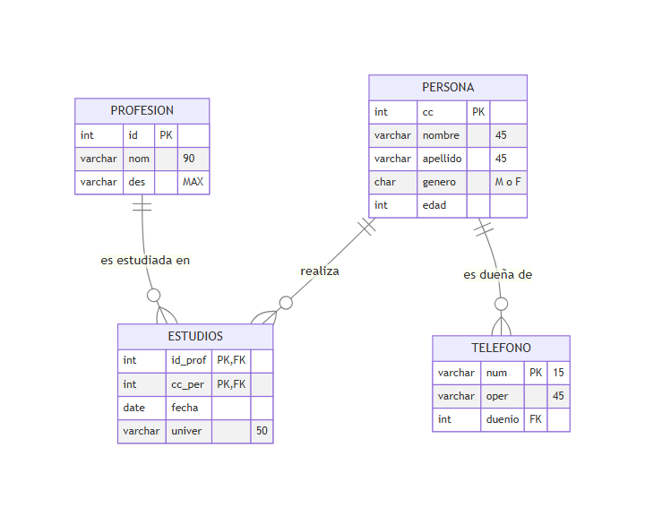
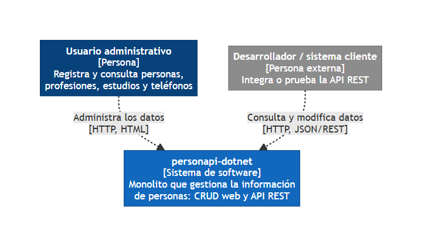
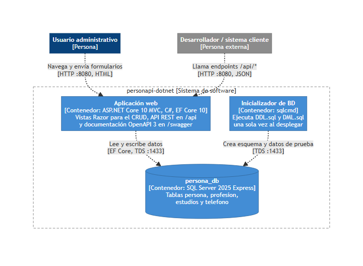
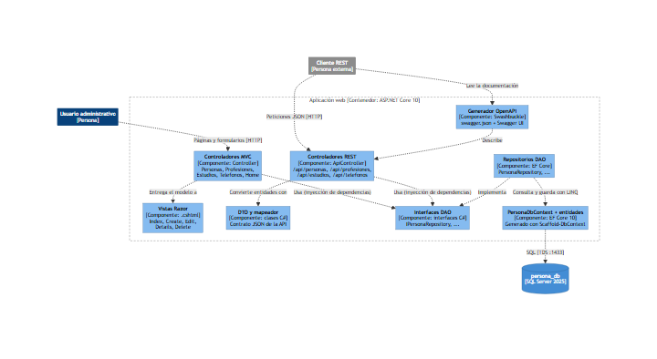
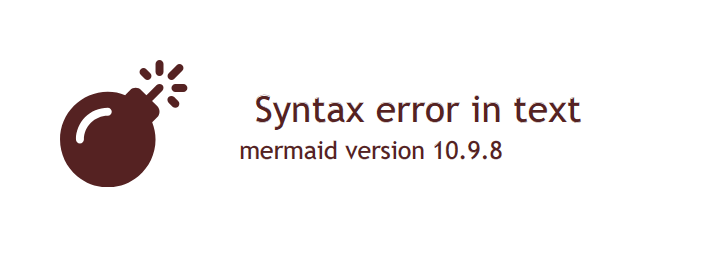
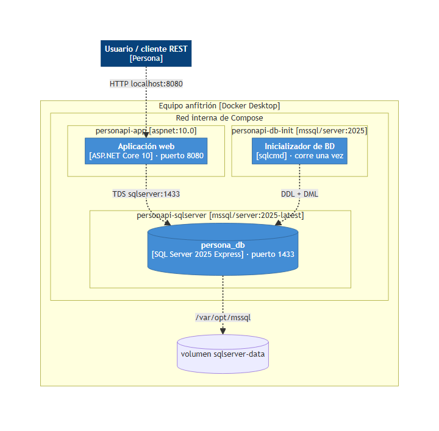
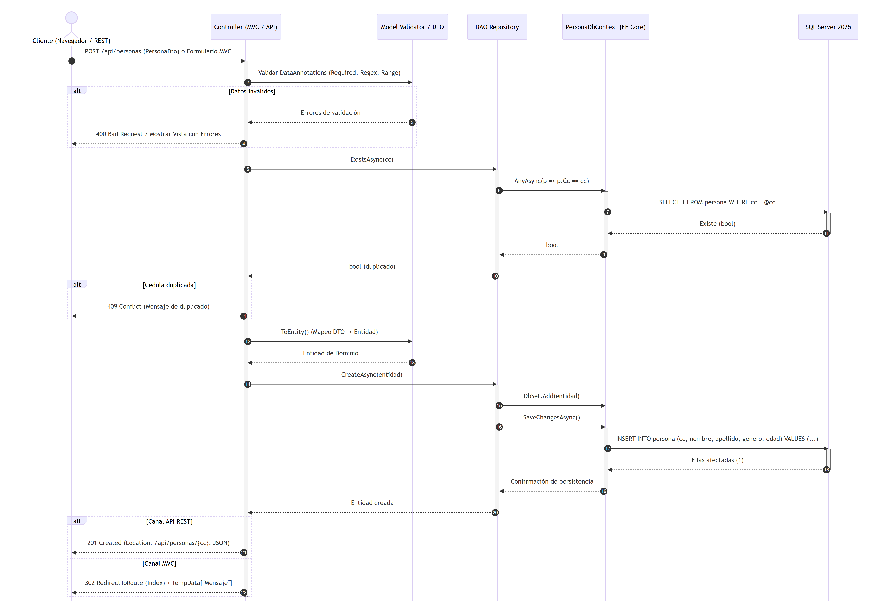
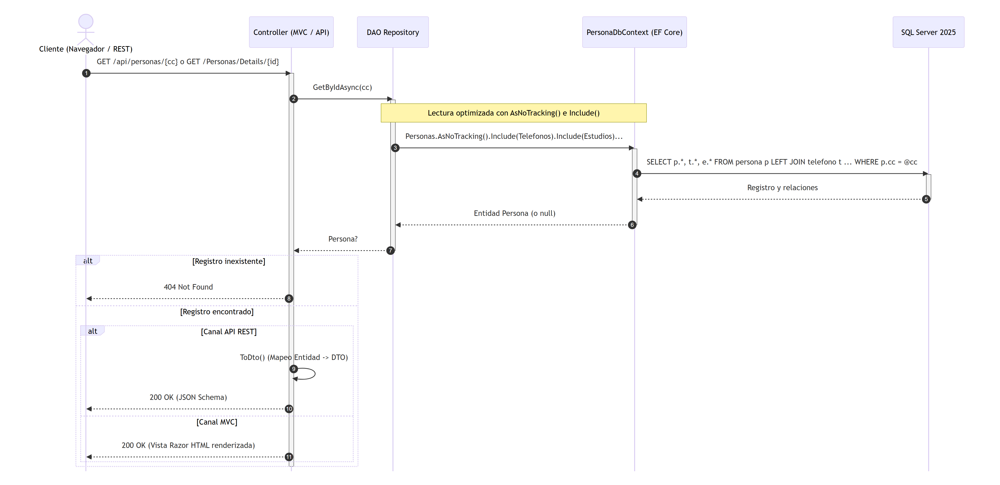
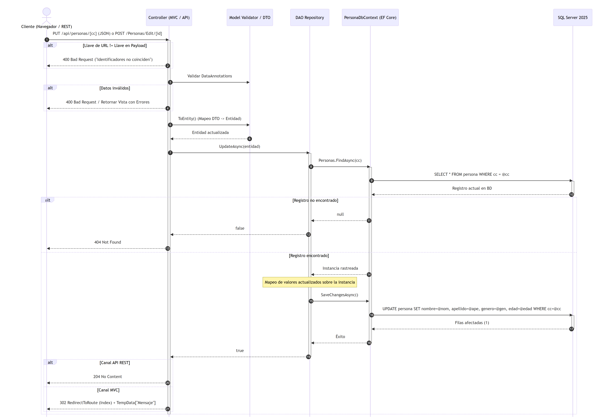
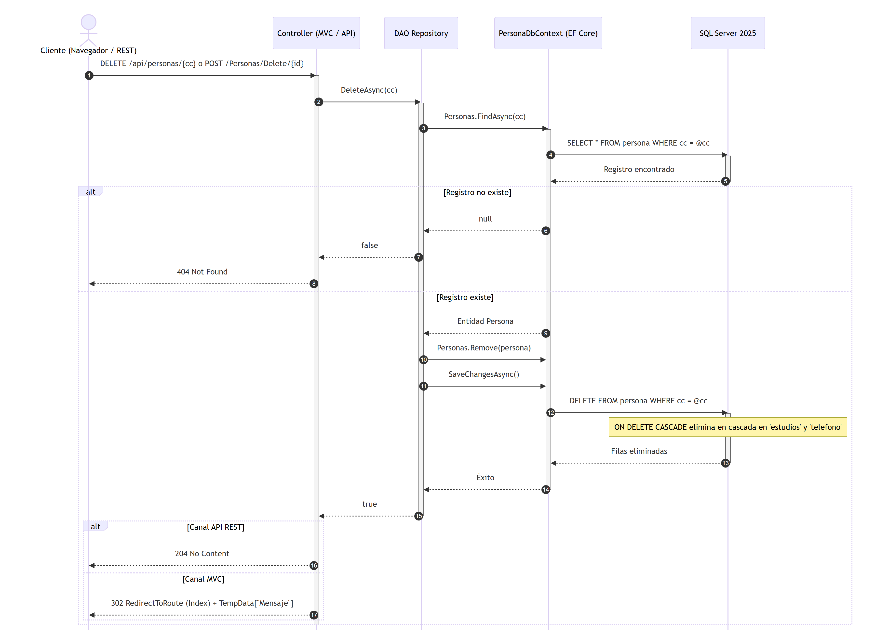

# Informe de Laboratorio 1: Implementación de Monolito con Patrón MVC y DAO

---

## Portada

- **Asignatura:** Arquitectura de Software
- **Práctica:** Laboratorio 1 — Implementación de Monolito con patrón MVC y DAO
- **Plataforma:** .NET 10 LTS · ASP.NET Core MVC & Web API · Entity Framework Core 10 · SQL Server 2025 Express · Docker
- **Integrantes (Grupo 3):**
  - Katherine Sofía Bravo Herrera
  - Daniel Avila Medina
  - Juan Sebastián Alvarez
- **Repositorio:** [https://github.com/KatheBravo/personapi-dotnet](https://github.com/KatheBravo/personapi-dotnet)
- **TAG de Entrega:** `v1.2`
- **Fecha:** Octubre 2026

---

## 1. Marco Conceptual

### 1.1 Arquitectura Monolítica
Una arquitectura monolítica agrupa todos los componentes del sistema de software (capa de presentación, lógica de negocio y capa de acceso a datos) dentro de una única unidad de despliegue y base de código. Entre sus ventajas destacan la simplicidad de desarrollo inicial, la facilidad de pruebas integrales locales y la ausencia de latencia de red entre capas internas.

### 1.2 Patrón Modelo - Vista - Controlador (MVC)
El patrón MVC separa las responsabilidades de una aplicación interactiva en tres componentes:
- **Modelo:** Representa la estructura de datos, reglas de validación y estado de la información del dominio.
- **Vista:** Es la representación gráfica con la que interactúa el usuario final (en este caso, vistas `.cshtml` procesadas por el motor Razor).
- **Controlador:** Intercepta las solicitudes HTTP entrantes, invoca los servicios del modelo y selecciona la vista apropiada para la respuesta.

### 1.3 Patrón Data Access Object (DAO) / Repository
El patrón DAO proporciona una interfaz abstracta que encapsula todas las operaciones de persistencia hacia el mecanismo de almacenamiento subyacente (base de datos relacional). Al programar contra interfaces (`IPersonaRepository`, etc.), los controladores se desacoplan por completo de la tecnología de acceso a datos (Entity Framework Core / SQL Server), facilitando la mantenibilidad y la sustitución tecnológica sin impacto en las capas superiores.

### 1.4 Object-Relational Mapping (ORM) con Entity Framework Core
Entity Framework Core es el ORM oficial de Microsoft para .NET. Permite mapear tablas de una base de datos relacional a clases POCO (Plain Old CLR Objects) de C#. En este proyecto se empleó la técnica **Database-First** mediante el comando `Scaffold-DbContext`, abstrayendo la ejecución de sentencias SQL mediante consultas LINQ fuertemente tipadas.

### 1.5 API RESTful y Especificación OpenAPI 3 / Swagger
Una API RESTful modela los recursos del sistema bajo URIs canónicas y utiliza los verbos del protocolo HTTP (`GET`, `POST`, `PUT`, `DELETE`) para reflejar las operaciones CRUD. La especificación OpenAPI (implementada vía Swashbuckle) genera una descripción formal en JSON y una consola interactiva (Swagger UI) que documenta esquemas, parámetros y códigos de estado HTTP.

### 1.6 Contenedores y Docker Compose
Docker empaqueta la aplicación junto a todas sus dependencias en imágenes reproducibles y portables. Docker Compose orquesta múltiples servicios (el motor de SQL Server 2025, un script de inicialización DDL/DML y el contenedor de la aplicación ASP.NET Core) comunicados a través de una red interna protegida.

---

## 2. Diseño del Sistema

### 2.1 Modelo Entidad - Relación (Base de Datos)
El dominio del laboratorio se compone de cuatro entidades principales adaptadas desde el modelo relacional base:
1. `persona`: Representa los individuos registrados (cédula como PK, nombres, apellidos, género con check 'M'/'F' y edad).
2. `profesion`: Catálogo de profesiones (id como PK, nombre y descripción).
3. `estudios`: Relación muchos a muchos entre personas y profesiones con clave primaria compuesta `(id_prof, cc_per)`, fecha de graduación y universidad.
4. `telefono`: Múltiples números telefónicos asociados a una persona (llave foránea `duenio` con `ON DELETE CASCADE`).

### 2.2 Arquitectura C4

#### Nivel 1: Diagrama de Contexto
El sistema interactúa con dos perfiles de clientes: usuarios administrativos a través del navegador web (HTML) y desarrolladores o sistemas externos a través de la API RESTful (JSON).

#### Nivel 2: Diagrama de Contenedores
El sistema se divide en tres contenedores desplegables:
- **`personapi-app`:** Aplicación ASP.NET Core 10 que sirve las vistas Razor y los endpoints REST.
- **`personapi-sqlserver`:** Instancia de Microsoft SQL Server 2025 Express.
- **`personapi-db-init`:** Contenedor efímero con `sqlcmd` que aprovisiona el esquema (`DDL.sql`) y la semilla de datos (`DML.sql`).

#### Nivel 3: Diagrama de Componentes
Dentro del contenedor web se estructuran los controladores MVC, controladores de API REST, clases DTO y sus respectivos mapeadores, la capa DAO (interfaces y repositorios) y el `PersonaDbContext`.

#### Nivel 4: Diagrama de Código (Patrón DAO)
Detalla la relación entre los controladores, la interfaz abstracta `IPersonaRepository`, su implementación `PersonaRepository` y el contexto de EF Core.

#### Diagrama de Despliegue
Mapeo de puertos hacia la máquina anfitriona (`8080` para web/api y `1433` para SQL Server), la red puente interna y el volumen de datos persistente `sqlserver-data`.

### 2.3 Diagramas de Secuencia UML (Operaciones CRUD)

Modelan la dinámica temporal entre los clientes, controladores, repositorios DAO, el contexto EF Core y la base de datos SQL Server:

- **Operación CREATE:** Valida el modelo con DataAnnotations, verifica unicidad de clave y persiste retornando HTTP 201 Created.
- **Operación READ:** Ejecuta consultas optimizadas con `AsNoTracking()` e `Include()` de relaciones, retornando HTTP 200 OK.
- **Operación UPDATE:** Valida coherencia de clave primaria, actualiza únicamente campos mutables y retorna HTTP 204 No Content.
- **Operación DELETE:** Elimina el registro y activa el borrado en cascada (`ON DELETE CASCADE`) en SQL Server, retornando HTTP 204 No Content.

| Creación (CREATE) | Lectura (READ) |
|---|---|
|  |  |

| Actualización (UPDATE) | Eliminación (DELETE) |
|---|---|
|  |  |

---

## 3. Procedimiento Paso a Paso

1. **Definición del Esquema de Base de Datos:**
   - Se diseñó el script `db/DDL.sql` para Microsoft SQL Server asegurando idempotencia (`IF DB_ID(...) IS NULL`), asignando al usuario `sa` como propietario y configurando integridad referencial con borrado en cascada (`ON DELETE CASCADE`).
   - Se construyó el script `db/DML.sql` con datos representativos para pruebas iniciales.

2. **Ingeniería Inversa del Modelo (Scaffold-DbContext):**
   - A partir de la base de datos se ejecutó el scaffold de Entity Framework Core generando las entidades (`Persona`, `Profesion`, `Estudio`, `Telefono`) y el `PersonaDbContext`.
   - Se desacoplaron las validaciones en `EntityMetadata.cs` mediante `[ModelMetadataType]` para proteger las reglas de negocio de futuros scaffolds.

3. **Implementación de la Capa DAO (Data Access Object):**
   - Se definieron contratos asíncronos en `Models/Interfaces/` (`IPersonaRepository`, etc.).
   - Se crearon las implementaciones concretas en `Models/Repositories/` utilizando `AsNoTracking()` para consultas de solo lectura e `Include()` para carga de entidades relacionadas.

4. **Desarrollo de Controladores:**
   - **Controladores MVC (`Controllers/*.cs`):** Implementan el flujo de vistas Razor con formularios interactivos, tokens anti-falsificación (`[ValidateAntiForgeryToken]`) y mensajes de confirmación con `TempData`.
   - **Controladores REST (`Controllers/Api/*.cs`):** Implementan los endpoints JSON RESTful utilizando DTOs para evitar ciclos de serialización cíclica y devolviendo códigos de respuesta HTTP canónicos (`200`, `201`, `204`, `400`, `404`, `409`).

5. **Configuración de Swagger y OpenAPI 3:**
   - En `Program.cs` se configuró Swashbuckle con metadatos descriptivos, tags organizados por entidad, inclusión de comentarios XML y opciones enriquecidas de Swagger UI (filtro de búsqueda, duración de peticiones y expansión automática).

6. **Contenerización y Orquestación con Docker Compose:**
   - Se creó un `Dockerfile` multi-stage optimizado que compila en `dotnet/sdk:10.0` y ejecuta en `dotnet/aspnet:10.0` bajo un usuario sin privilegios (`$APP_UID`).
   - Se configuró `docker-compose.yml` orquestando la base de datos con healthchecks y arranque coordinado (`depends_on`).

---

## 4. Conclusiones y Lecciones Aprendidas

1. **Separación de Responsabilidades:** El desacoplamiento entre controladores y persistencia mediante el patrón DAO permitió reutilizar exactamente la misma lógica de acceso a datos tanto para las vistas Razor como para los endpoints REST, evitando duplicidad de código.
2. **Uso de DTOs en APIs REST:** Exponer entidades de base de datos directamente en una API genera vulnerabilidades de asignación masiva (*over-posting*) y fallos de serialización circular debido a las propiedades de navegación de EF Core. El uso de DTOs y mapeadores resolvió este problema de forma limpia.
3. **Reproducibilidad Garantizada con Docker:** Estandarizar la solución en Docker Compose eliminó por completo los problemas de diferencias de versiones entre entornos de desarrollo (por ejemplo, tener .NET 6 en el sistema operativo anfitrión mientras la aplicación compila y corre en .NET 10 LTS dentro del contenedor).
4. **Documentación Viva con OpenAPI:** Mantener Swagger sincronizado con los comentarios XML del código fuente y los esquemas de validación de los DTOs asegura que la documentación técnica esté siempre actualizada sin esfuerzo adicional.

---

## 5. Referencias

1. Microsoft Docs. *ASP.NET Core MVC Overview*. https://learn.microsoft.com/aspnet/core/mvc/overview
2. Microsoft Docs. *Entity Framework Core Database-First approach*. https://learn.microsoft.com/ef/core/managing-schemas/scaffolding
3. Brown, Simon. *The C4 Model for Visualising Software Architecture*. https://c4model.com/
4. Fielding, Roy Thomas. *Architectural Styles and the Design of Network-based Software Architectures* (REST). Doctoral dissertation, University of California, Irvine, 2000.
5. Docker Documentation. *Docker Compose Overview*. https://docs.docker.com/compose/
